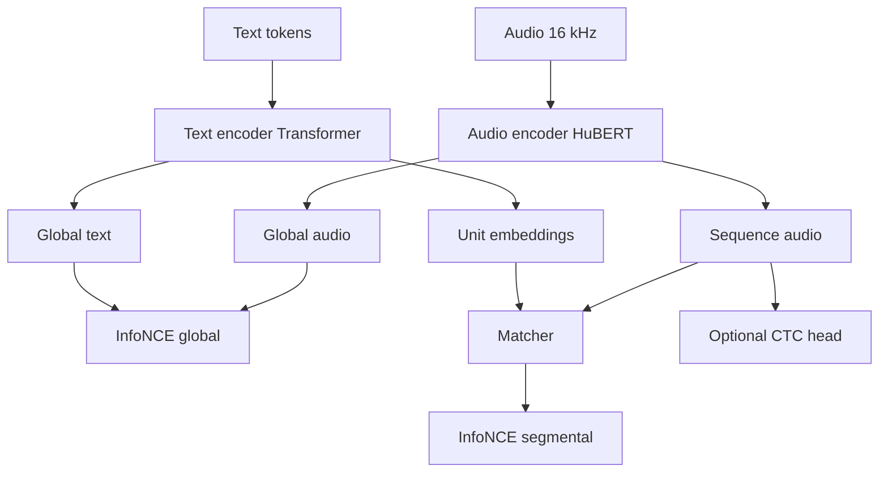

<p align="center">
  <a href="README.md"><b>English</b></a>
  &nbsp;·&nbsp;
  <a href="README.fr.md">Français</a>
  &nbsp;·&nbsp;
  <a href="README.es.md">Español</a>
</p>

# ELUS — Espace Latent Unifié pour l'ASR

**ELUS** (*Espace Latent Unifié pour l'ASR*) is a **bidirectional speech–text** system built on a **shared latent space**.  
Instead of a classic autoregressive decoder, ELUS aligns audio and text with contrastive learning (InfoNCE), then retrieves by similarity.

| Direction | Task | Status |
|-----------|------|--------|
| **Text → audio** | Find an utterance / track from a text query | **Strong** (full phrases) |
| **Audio → text** | Open ASR via nearest-neighbour / DTW | Weak without CTC |
| **Audio → text (CTC head)** | Linear CTC on top of ELUS audio frames | **Working** on Ewe (~55% WER) |

Primary language: **Ewe** (Ghana/Togo). Validation language: **English** (LibriSpeech 100h).  
Optional demo: **playlist finder** (partial lyrics → song) via Gradio.

---

## Table of contents

1. [Motivation](#1-motivation)
2. [Core idea](#2-core-idea)
3. [Architecture](#3-architecture)
4. [Training objectives](#4-training-objectives)
5. [What works / what does not](#5-what-works--what-does-not)
6. [Experimental results](#6-experimental-results)
7. [CTC extension](#7-ctc-extension)
8. [Hybrid Whisper + ELUS](#8-hybrid-whisper--elus)
9. [Playlist demo app](#9-playlist-demo-app)
10. [Data](#10-data)
11. [Installation](#11-installation)
12. [Usage](#12-usage)
13. [SLURM / cluster](#13-slurm--cluster)
14. [Repository layout](#14-repository-layout)
15. [Limitations & future work](#15-limitations--future-work)
16. [References](#16-references)
17. [Licence](#17-licence)

---

## 1. Motivation

Classical ASR:

```text
Audio → Encoder → Autoregressive / CTC decoder → characters or words
```

ELUS asks a different question:

> Can speech and text live in **one** vector space so that  
> (a) a phrase retrieves its audio, and  
> (b) audio frames retrieve text units — **without** a heavy seq2seq decoder?

This matters especially for **low-resource languages** (e.g. Ewe), where large decoder LMs are expensive and bilingual transfer is attractive.

---

## 2. Core idea

```text
Audio  → E_a (HuBERT / AfriHuBERT) → sequence + global vectors  ─┐
                                                                  ├─→ shared latent (256-D)
Text   → E_t (Transformer)         → unit     + global vectors  ─┘
                                                                  │
                         Matcher (cross-attention) ───────────────┘
```

- **Global** embeddings → phrase-level bidirectional retrieval (CLIP-like).  
- **Segmental** embeddings → frame ↔ character/word alignment.  
- **Inference (retrieval)**: encode query text, cosine-search against indexed audio.  
- **Inference (ASR without CTC)**: map frames toward text space, nearest neighbour over a unit lexicon (works poorly as open ASR).  
- **Inference (ASR with CTC)**: small linear head + CTC collapse on audio frames (compatible with ELUS).

---

## 3. Architecture

### 3.1 Audio encoder (`audio_encoder.py`)

| Item | Ewe | English |
|------|-----|---------|
| Backbone | [`ajesujoba/AfriHuBERT`](https://huggingface.co/ajesujoba/AfriHuBERT) | `facebook/hubert-base-ls960` |
| Backbone dim | 768 | 768 |
| Latent dim | 256 | 256 |
| Sample rate | 16 kHz | 16 kHz |
| CNN feature extractor | Frozen | Frozen |
| Transformer layers fine-tuned | Last *N* (configurable) | Last *N* |
| Temporal downsample | Factor 4 (~80 ms / unit after pool) | Factor 4 |

Outputs:

- `sequence_embeddings` — L2-normalized frame vectors `(B, T, 256)`
- `global_embedding` — attentive pool `(B, 256)`
- `seq_mask` — valid frames

### 3.2 Text encoder (`text_encoder.py`)

| Item | Value |
|------|--------|
| Type | Transformer encoder |
| Layers / heads | 4 / 4 |
| Embedding & latent | 256 |
| Special token | `[CLS]` → global phrase vector |

Tokenisation:

- **Ewe**: mainly **characters** (incl. `ɖ`, `ƒ`, `ŋ`, tones, …)
- **English (LibriSpeech run)**: **word-level** units (`w:the`, …) + characters in vocab file

### 3.3 Matcher (`matcher.py`)

Projects audio sequence into text space (`f(V_a) → V_t`):

| Kind | Role |
|------|------|
| `mlp` | Per-frame MLP baseline |
| `attention` (**default**) | Cross-attention: audio queries text keys/values |

Training: text of the **same** utterance.  
Lexicon decoding: full vocabulary as context (nearest neighbour).

### 3.4 Full model (`model.py`)

`ELUSModel` wires encoders + matcher + losses, and exposes:

- contrastive `forward`
- `retrieve_audio` / phrase retrieval helpers
- optional `CTCHead` + `forward_ctc`
- experimental DTW / `transcribe_phrase` paths (limited success without CTC)



---

## 4. Training objectives

### 4.1 Global InfoNCE (phrase ↔ phrase)

Symmetric batch contrastive loss between global audio and global text embeddings.  
This is what makes **text → audio** retrieval strong.

### 4.2 Segmental InfoNCE (frame ↔ unit)

Each (downsampled) audio frame is pulled toward a target text unit (word or char), with hard negatives in a local window.

- Default weight: `segmental_weight = 0.15` (keeps global retrieval stable)
- Optional **forced alignments** (`align.py`, `build_alignments.py`) for words/chars
- Temperature / weights: see `config.py` → `LossConfig`

### 4.3 Total loss

```text
L = λ_global · L_global + λ_segmental · L_segmental
```

Optimiser: AdamW, mixed precision (FP16) on GPU when available.

---

## 5. What works / what does not

Critical empirical finding of this project:

> **Bidirectional InfoNCE ≠ open ASR.**  
> Shared space alignment is excellent for **paired phrase retrieval**.  
> Frame → open text generation still needs **strong segmental / CTC** supervision.

| Capability | Ewe (v3) | English 100h |
|------------|----------|--------------|
| Text → audio (full phrase) | Excellent (R@1 ≈ 1.0) | **10/10** on 50 test-clean pool |
| Short text query (≈3 words) | Weak | Weak |
| Audio → text (DTW / NN lexicon) | ~0% usable ASR | ~0% |
| Oracle paired forward check | Strong | Strong |
| CTC ASR (chars) | Val WER ≈ **46.8%**, test ≈ **55.3%** | Not fully reported in-repo |

**Singing / music:** ELUS is trained on **speech**. Text→audio on *sung* music is unreliable; lyric `.txt` sidecars help the playlist demo.

---

## 6. Experimental results

### 6.1 Ewe contrastive (v3)

- Checkpoint: `elus_ewe_v3_best.pt`
- Strong global retrieval on validation
- Segmental weight 0.15
- Open audio→text without CTC remains unusable

### 6.2 Ewe CTC (linear head)

Two-phase training (`train_ctc.py`, `train_ctc_ewe.slurm`):

1. Freeze encoder → train CTC head on characters  
2. Unfreeze last AfriHuBERT layers  

Approximate metrics (held-out eval):

| Split | WER | CER |
|-------|-----|-----|
| Validation (best) | ~46.8% | — |
| Test (~200 utt.) | ~55.3% | ~20.9% |

Checkpoint: `elus_ewe_ctc_best.pt`

### 6.3 English LibriSpeech 100h

- Backbone: `facebook/hubert-base-ls960`
- Word-level segmental loss + forced word alignments
- Effective batch size 32
- Val retrieval: **R@1 ≈ 0.994**, **R@5 = 1.0**
- Early stop ~epoch 14
- Checkpoint: `elus_librispeech_100h_best.pt`
- Phrase retrieval test: **10/10** on a pool of 50 `test-clean` utterances
- Open ASR via DTW still fails (same architectural limit)

---

## 7. CTC extension

Files: `ctc_head.py`, `train_ctc.py`, `eval_ctc.py`, `wer.py`

Design choice (kept compatible with ELUS philosophy):

- **No** heavy autoregressive decoder
- **Linear** projection from audio latent frames → character logits
- Standard **CTC** loss + collapse at decode time

This is the practical path from “aligned space” to **readable transcripts**.

```bash
python train_ctc.py \
  --checkpoint checkpoints/elus_ewe_v3_best.pt \
  --parquet_dir /path/to/data_ewe \
  --save_path checkpoints/elus_ewe_ctc_best.pt

python eval_ctc.py \
  --checkpoint checkpoints/elus_ewe_ctc_best.pt \
  --parquet_dir /path/to/data_ewe \
  --split test
```

---

## 8. Hybrid Whisper + ELUS

File: `hybrid_asr.py`

Pipeline:

1. Whisper (fine-tuned Ewe medium) produces beam hypotheses  
2. ELUS scores / reranks with paired audio–text embeddings  

Observed: when ELUS contrastive v3 does not discriminate hypotheses, hybrid WER ≈ Whisper alone (~27–28% in partial runs).  
More promising once CTC / stronger segmental ELUS is in the loop.

Whisper Ewe weights (external path used in experiments):  
fine-tuned Whisper medium for Ewe + HF processor bundle on the lab cluster.

---

## 9. Playlist demo app

**Goal:** “I remember some lyrics, not the title” → find the track in a local playlist.

| File | Role |
|------|------|
| `playlist_index.py` | Index audio with ELUS (windowed embeddings); optional lyric sidecars |
| `app_playlist.py` | Gradio UI |
| `run_playlist_app.sh` | Server launch helper |

**Default path = audio ELUS (text → audio).**  
Whisper transcription is **optional** (advanced accordion), not required by design.

```bash
python app_playlist.py \
  --checkpoint checkpoints/elus_librispeech_100h_best.pt \
  --vocab checkpoints/symbols_en.json \
  --playlist /path/to/music \
  --share
```

Modes:

- `audio` — query text vs indexed **audio** embeddings (true ELUS retrieval)
- `lyrics` — if `.txt` / `.lrc` exist beside tracks
- `hybrid` — blend both

Demo tracks (public-domain traditional songs) can live under `test_songs/` (audio binaries are **gitignored**; lyrics `.txt` may be included).

---

## 10. Data

### 10.1 Ewe (Parquet)

Typical layout:

```text
data_ewe/
├── ewe-train-*.parquet
├── ewe_validation_clean.parquet
└── ewe_test_clean.parquet
```

Columns (approx.): embedded audio bytes, transcription, speaker metadata (`ee_gh`).

~30k training utterances; character vocabulary includes Ewe-specific glyphs.

### 10.2 LibriSpeech

```text
LibriSpeech/
├── train-clean-100/
├── dev-clean/
└── test-clean/
```

Helper: `download_librispeech.sh`

### 10.3 Alignments

```bash
python build_alignments.py --level words   # or chars
```

Produces stores consumed when `use_forced_alignments=True`.

### 10.4 Audio I/O note (important on some GPUs)

Importing / using **torchaudio** around CUDA init caused **GPU segfaults** on Tesla P100 nodes in this project.  
Loading uses **`soundfile` / `librosa`** instead (`data.py`). Prefer `torch.cuda.init()` before heavy imports in training entrypoints when needed.

---

## 11. Installation

```bash
git clone https://github.com/KELI-Kekeli-Christ/ELUS-ASR.git
cd ELUS-ASR

python -m venv .venv
source .venv/bin/activate   # Windows: .venv\Scripts\activate
pip install -r requirements.txt
```

**Requirements (see `requirements.txt`):**

- `torch`, `transformers`, `pyarrow`
- `soundfile`, `librosa` (audio decode without torchaudio CUDA issues)
- `gradio` (playlist UI)

HuggingFace cache (cluster-friendly):

```bash
export HF_HOME=/path/to/hf_cache
export HUGGINGFACE_HUB_CACHE=$HF_HOME/hub
```

Checkpoints and datasets are **not** shipped in git (too large). Train locally or copy from your experiment store.

---

## 12. Usage

### 12.1 Train contrastive ELUS (Ewe)

```bash
python train.py \
  --parquet_dir /path/to/data_ewe \
  --split train \
  --batch_size 8 \
  --epochs 20 \
  --matcher attention \
  --save_path checkpoints/elus_ewe.pt
```

Smoke test:

```bash
./run_train.sh smoke
# or
python train.py --parquet_dir /path/to/data_ewe --max_files 1 --max_steps 1 --batch_size 2 --num_workers 0
```

### 12.2 Train English (LibriSpeech)

```bash
sbatch train_elus_librispeech.slurm
# or equivalent local flags in train.py for LibriSpeechDataset
```

### 12.3 Evaluate retrieval / inference

```bash
python eval.py --checkpoint checkpoints/elus_ewe_v3_best.pt ...
python test_inference.py --checkpoint checkpoints/elus_librispeech_100h_best.pt ...
python infer.py --checkpoint ... --vocab ... --audio sample.wav
```

### 12.4 CTC train / eval

```bash
sbatch train_ctc_ewe.slurm
python eval_ctc.py --checkpoint checkpoints/elus_ewe_ctc_best.pt ...
```

### 12.5 Playlist app

```bash
./run_playlist_app.sh /path/to/playlist
# open the printed Gradio URL
```

---

## 13. SLURM / cluster

Example scripts included:

| Script | Purpose |
|--------|---------|
| `train_elus.slurm` | Ewe contrastive |
| `train_elus_v4.slurm` / `train_elus_v4b.slurm` | Segmental / alignment variants |
| `train_elus_librispeech.slurm` | English 100h |
| `train_ctc_ewe.slurm` | Ewe CTC |
| `test_librispeech.slurm` / `test_inference.slurm` | Retrieval tests |
| `eval_hybrid.slurm` | Whisper + ELUS hybrid |

Typical GPU partition: 1× Tesla P100 16GB, multi-CPU, long walltime.  
Monitor:

```bash
squeue -u $USER
tail -f logs/slurm_<JOBID>.out
```

---

## 14. Repository layout

```text
ELUS-ASR/
├── README.md                 # This document
├── requirements.txt
├── config.py                 # Audio / text / matcher / loss dataclasses
├── audio_encoder.py          # HuBERT / AfriHuBERT + projection + pool
├── text_encoder.py           # Transformer text encoder
├── matcher.py                # MLP or cross-attention bridge
├── losses.py                 # Global + segmental InfoNCE
├── model.py                  # ELUSModel (+ optional CTC)
├── ctc_head.py               # Linear CTC head
├── data.py                   # Ewe Parquet + LibriSpeech datasets
├── align.py / build_alignments.py
├── train.py                  # Contrastive training loop
├── train_ctc.py              # CTC fine-tuning
├── eval.py / eval_ctc.py / wer.py
├── infer.py                  # CLI inference
├── hybrid_asr.py             # Whisper beam + ELUS rerank
├── playlist_index.py         # Playlist embedding index
├── app_playlist.py           # Gradio UI
├── run_playlist_app.sh
├── run_train.sh
├── download_librispeech.sh
├── *.slurm                   # Cluster jobs
├── test_*.py                 # Retrieval / checkpoint / corpus tests
└── test_songs/               # Optional demo lyrics (audio gitignored)
```

---

## 15. Limitations & future work

| Limitation | Direction |
|------------|-----------|
| Contrastive ELUS alone ≠ open ASR | Keep / improve CTC (or similar) head |
| Short queries weak for retrieval | Query expansion, multi-window audio index (started in playlist app) |
| Singing ≠ speech | Speech-only demos, or music-specialised encoders |
| Forced alignment quality | Better MFA / Whisper timestamps |
| Cross-lingual Ewe ↔ EN map | Needs parallel bitext; NLLB can help translation side |
| Large shards / MP3 edge cases | Streaming datasets; robust librosa path already used |

---

## 16. References

- **AfriHuBERT** — Alabi et al., 2024 — [arXiv:2409.20201](https://arxiv.org/abs/2409.20201)  
- **HuBERT** — Hsu et al., 2021 — [arXiv:2106.07447](https://arxiv.org/abs/2106.07447)  
- **InfoNCE / CLIP-style contrastive learning** — shared multimodal spaces  
- **CTC** — Graves et al. — connectionist temporal classification  

Academic context: APS project work (Université d'Avignon / LIA) on unified latent ASR for low-resource African languages, with English validation on LibriSpeech.

---

## 17. Licence

Apache License 2.0 — see project licence terms for code.  
Third-party models (HuBERT, AfriHuBERT, Whisper) remain under their respective licences.  
Do not redistribute copyrighted music; demo songs should be public-domain / CC only.

---

## Acknowledgements

- AfriHuBERT & African speech SSL community  
- LibriSpeech  
- Université d'Avignon GPU cluster for training runs  
- Optional Whisper Ewe fine-tunes used in hybrid experiments  

---

### Quick start (shortest path)

```bash
git clone https://github.com/KELI-Kekeli-Christ/ELUS-ASR.git
cd ELUS-ASR
pip install -r requirements.txt

# After you place a checkpoint + vocab:
python app_playlist.py --checkpoint /path/to/ckpt.pt --vocab /path/to/symbols.json --playlist /path/to/wavs --share
```

For research training, start from `train.py` (Ewe) or `train_elus_librispeech.slurm` (English), then optionally `train_ctc.py` when you need transcripts.
